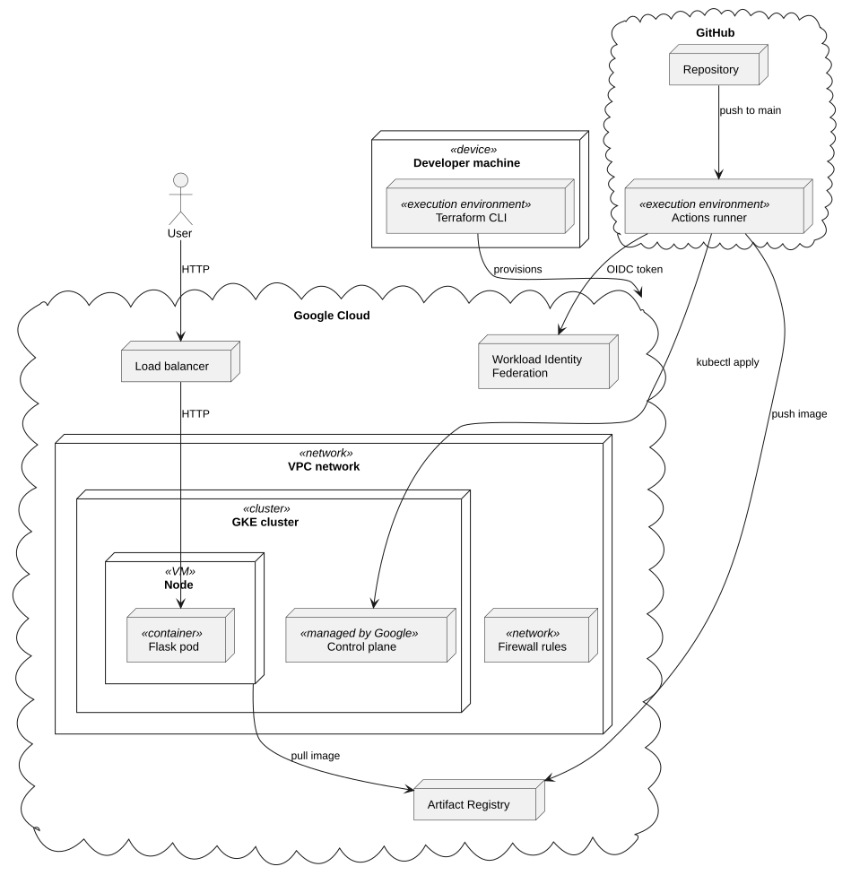
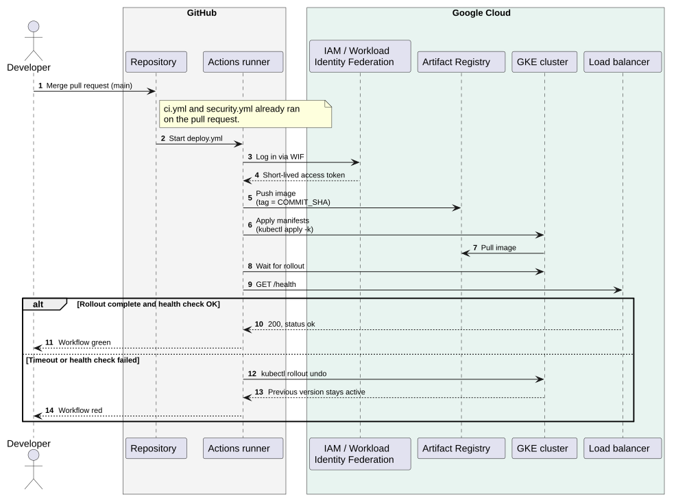

# GKE Terraform CI/CD Pipeline

[](https://github.com/lorenz00k/gke-terraform-cicd-pipeline/actions/workflows/ci.yml)
[](https://github.com/lorenz00k/gke-terraform-cicd-pipeline/actions/workflows/security.yml)
[](https://github.com/lorenz00k/gke-terraform-cicd-pipeline/actions/workflows/deploy.yml)


A containerized Flask app on Google Kubernetes Engine (GKE), with the infrastructure
provisioned by Terraform and delivered through an automated GitHub Actions CI/CD pipeline.

## Goal

Build a small but complete delivery pipeline and show how a code change travels from a
commit to a running workload on Kubernetes without manual steps.

- **Infrastructure as code:** the network, the GKE cluster and the container registry are defined in Terraform.
- **Continuous integration:** every pull request is linted, type-checked, tested and scanned for security issues before it can be merged.
- **Continuous deployment:** a merge to `main` builds the image, pushes it to Artifact Registry and deploys it to GKE.
- **Safe releases:** a post-deploy health check rolls back automatically if the new version does not come up.
- **No stored credentials:** GitHub Actions authenticates to Google Cloud through Workload Identity Federation instead of a long-lived key.

The app itself is intentionally minimal. The focus is the pipeline around it.

## Architecture


- **GitHub Actions** runs the tests, security scans and the deployment.
- **Workload Identity Federation** lets the pipeline authenticate to Google Cloud with short-lived tokens, so no key is stored.
- **Artifact Registry** stores the container images, tagged with the commit SHA.
- **GKE** runs the app in its own VPC, and a load balancer exposes it.
- **Terraform** provisions the network, the cluster and the registry.

### Pipeline flow



A merge to `main` builds and pushes the image, applies the manifests and checks `/health`.
If the check fails, the deployment is rolled back.

## Tech Stack

- **Terraform:** VPC, firewall, GKE cluster and Artifact Registry
- **Docker:** container image of the Flask app
- **Kubernetes (GKE):** runs the app, manifests applied with Kustomize
- **GitHub Actions:** CI/CD workflows
- **Python (Flask):** the demo app
- **Google Cloud:** GKE, Artifact Registry, Workload Identity Federation
- **Quality and security tools:** ruff, mypy, pytest, gitleaks, Bandit, pip-audit, Checkov, Trivy, Dependabot

## Setup

**Prerequisites:** a GCP project with billing enabled, `gcloud`, Terraform and a GitHub repository (a fork or copy of this one).

1. **Login into gcloud:**
    ```bash
    gcloud auth login
    gcloud auth application-default login # for terraform
    ```

2. **Provision the infrastructure:**
    ```bash
    cd terraform
    terraform init
    terraform apply
    ```
   Project-specific values go into `terraform/terraform.tfvars` (see `variables.tf`).
<br>

3. **Set up keyless authentication (Workload Identity Federation):** 
The included script creates the workload identity pool, an OIDC provider restricted to your repository and the `main` branch, and a service account with the roles `roles/artifactregistry.writer` and `roles/container.developer`. With `--set-github-variables` it also sets the two GitHub variables `WIF_PROVIDER` and `WIF_SERVICE_ACCOUNT`:
    ```bash
    gcloud auth login
    gh auth login   # only needed for --set-github-variables
    ./scripts/setup-wif.sh --project <project-id> --repo <owner>/<repo> --set-github-variables
    ```
   Without `--set-github-variables` the script prints the two values instead, and you add them under Settings &rarr; Secrets and variables &rarr; Actions &rarr; Variables.

   If you prefer to set it up by hand, follow the walkthrough in [google-github-actions/auth](https://github.com/google-github-actions/auth) and create the same two variables. `WIF_PROVIDER` is the full resource name of the provider, `WIF_SERVICE_ACCOUNT` is the email of the service account.
<br>

4. **Match the workflow to your project:** 
The values in the `env` block of `.github/workflows/deploy.yml` (project, region, zone, repository, cluster) must match `terraform/variables.tf`.
<br>

5. **Deploy:** push to `main`, or run the `deployment` workflow from the Actions tab. After a fresh `terraform apply` nothing triggers a deploy on its own, so start it manually.
<br>

6. **Verify the deployment:** get the cluster credentials, then look up the external IP of the service and call the health endpoint:
    ```bash
    gcloud container clusters get-credentials gke-demo-cluster --zone europe-west3-a --project <project-id>
    kubectl get service app-service -n gke-terra
    curl http://<EXTERNAL-IP>/health
    ```
    The service can show `<pending>` for a minute while the load balancer is created. The health endpoint answers with status `ok`.

**Clean up:** run `terraform destroy`. The cluster costs money while it runs.

## Design Decisions

- **Images are tagged with the commit SHA.** Every deploy applies a new image reference, and every running version traces back to a commit. With `latest`, Kubernetes would have nothing to roll out and there would be no way back.
- **Keyless authentication.** GitHub Actions logs in to Google Cloud through Workload Identity Federation with short-lived tokens, restricted to this repository and the `main` branch. No service account key is stored anywhere. `scripts/setup-wif.sh` sets it up.
- **Automatic rollback.** A deploy only counts once `/health` answers after the rollout. If it doesn't, the pipeline runs `kubectl rollout undo` and the workflow fails.
- **Security findings are fixed or documented.** Five scans (gitleaks, Bandit, pip-audit, Checkov, Trivy) run on every pull request. Each finding is fixed or skipped with a reason in a comment next to the resource.
- **Branch rules are the gate.** `main` requires a pull request and passing checks, and the deploy relies on that instead of re-running CI.

## Limitations & Next Steps

- **Terraform runs locally.** The state is a local file. Next: remote state in a GCS bucket with locking, `terraform plan` on pull requests and `terraform apply` after a manual approval, using a separate, narrower service account.
- **No TLS.** The app is reachable over HTTP via the load balancer. Next: an ingress with a domain name and a managed certificate. 
- **Every merge deploys.** There is one environment and no manual approval, so each merge to `main` goes live automatically. A failed health check triggers the rollback. Next: a staging environment with a manual approval for production, and path filters so documentation changes don't redeploy.
- **Push-based deployment.** The pipeline holds cluster credentials and applies the manifests itself. Next: GitOps with Argo CD or Flux, where a controller in the cluster pulls the desired state from Git and the pipeline only updates the image tag.